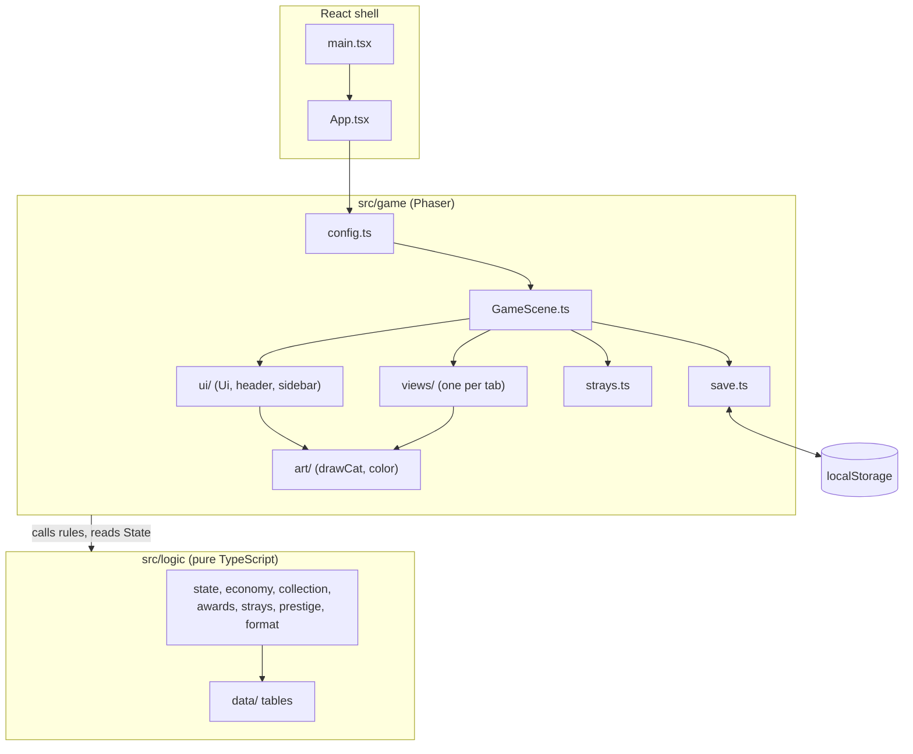
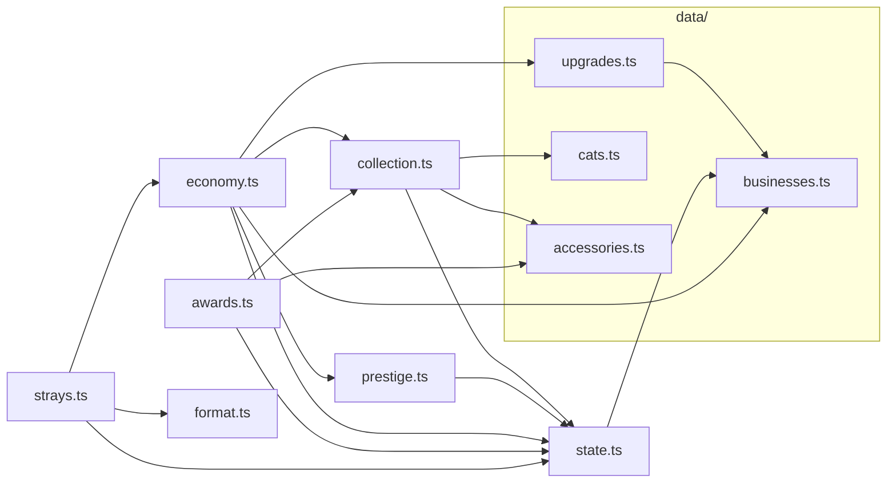
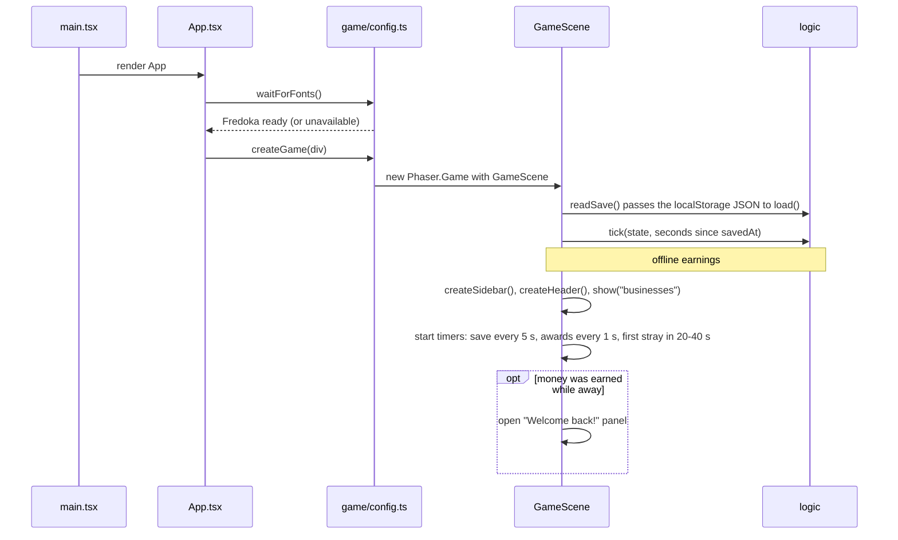
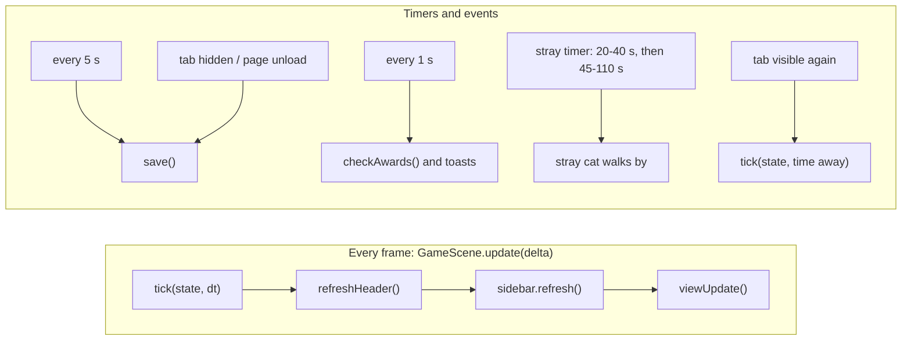
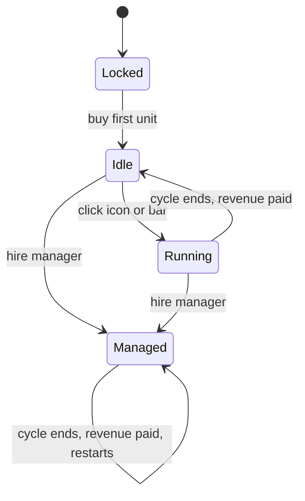
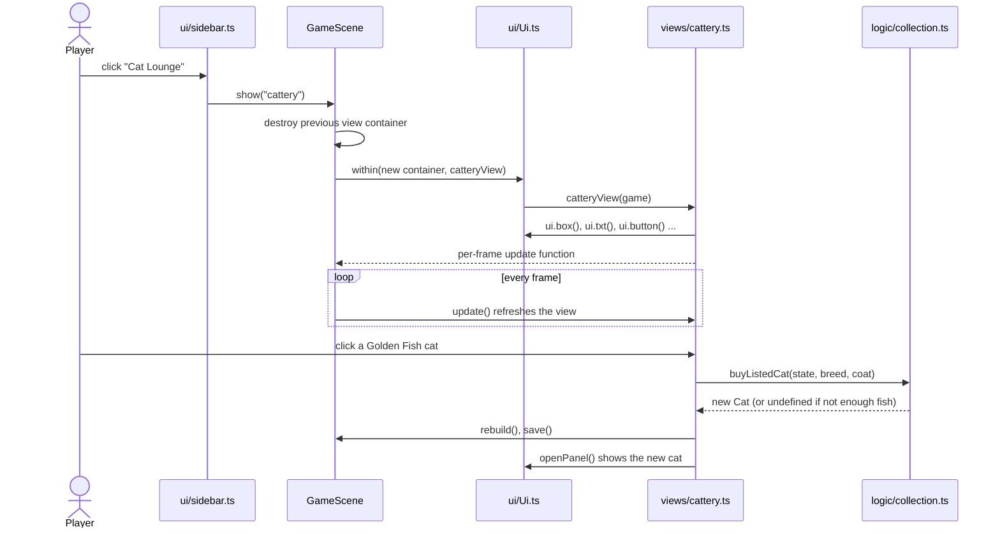
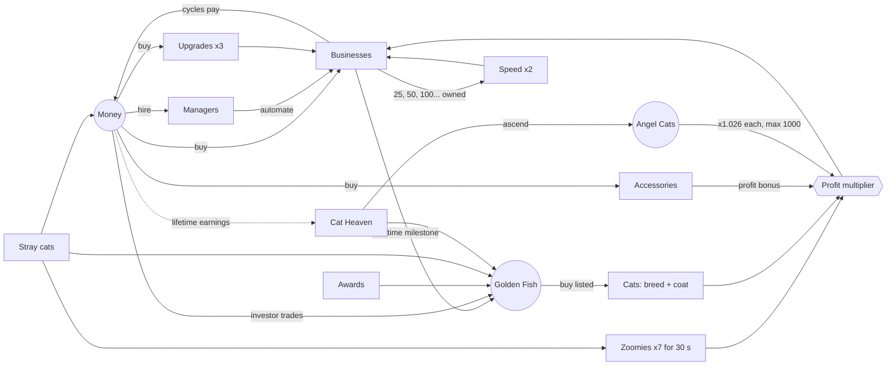

# Cat Capitalist: architecture and design reference

Technical notes for working on the game. For what the game is and how to run it, see the [README](README.md).

## Desktop shell

The game runs as a [Tauri 2](https://tauri.app) app (`src-tauri/`) that hosts the same web build. It opens fullscreen, F11 switches to a resizable window, and `src/game/ui/windowControls.ts` adds the exit confirmation. In a browser those controls stay off. `pnpm dev:web` runs the browser version.

## Project structure

```
src/
├─ main.tsx                  React entry point
├─ App.tsx                   Mounts the Phaser game into a <div>
├─ styles/index.css          Full-screen page background
│
├─ logic/                    Game rules. Pure TypeScript, no Phaser, runs in Node
│  ├─ data/                  Static tables
│  │  ├─ businesses.ts       10 businesses, milestone thresholds
│  │  ├─ upgrades.ts         57 profit upgrades (generated from businesses)
│  │  ├─ cats.ts             Rarities, 8 breeds, 8 coat colors, Golden Fish-priced cats
│  │  ├─ accessories.ts      Accessory slots and accessories
│  │  ├─ catShop.ts          Cat Shop prices and requirements
│  │  ├─ superManagers.ts    Super manager names, prices, rewards
│  │  ├─ investors.ts        Investor offers
│  │  ├─ diamonds.ts         Diamond odds, Diamond-priced cats
│  │  ├─ music.json          Music track list (title, fileName, price, gain)
│  │  ├─ iconNames.ts        Every icon name the rules and data can use
│  │  └─ permanentUpgrades.ts  Permanent Golden Fish upgrades and their requirements
│  ├─ state.ts               State types, new game, spend(), save parsing
│  ├─ economy.ts             Cycle times, revenue, costs, buying, tick()
│  ├─ collection.ts          Cat discovery, listed cats, accessory equipping, collection bonus
│  ├─ catShop.ts             Mystery cat purchases
│  ├─ investors.ts           Investments: status, starting, collecting
│  ├─ music.ts               Track ownership and selection
│  ├─ cheats.ts              Cheat codes
│  ├─ awards.ts              58 awards and their unlock checks
│  ├─ strays.ts              Stray cat rewards
│  ├─ prestige.ts            Angel Cats and ascending
│  ├─ unlocks.ts             Discovery state behind the NEW tags and sidebar stars
│  ├─ tips.ts                Early-game hints and the free first manager
│  ├─ victory.ts             What owning everything means
│  ├─ format.ts              Money / time / percent formatting
│  ├─ check.ts               Assertion-based self-check of the rules
│  └─ balance.ts             Bot-driven pacing report for every phase of the game
│
└─ game/                     Everything Phaser
   ├─ config.ts              Phaser.Game config, font preloading
   ├─ GameScene.ts           The single scene: state owner, game loop, tab switching
   ├─ constants.ts           Canvas size, layout, colors, font, buy modes
   ├─ save.ts                localStorage read/write
   ├─ music.ts               Background music player, independent of tabs
   ├─ sfx.ts                 Sound effect player: cooldowns, priorities, autoplay handling
   ├─ sfxCues.ts             Sound catalog: which files each game event plays
   ├─ strays.ts              Spawns the walking stray cat
   ├─ art/
   │  ├─ color.ts            Color mixing helpers
   │  ├─ pen.ts              Drawing helpers shared by all icons
   │  ├─ icons.ts            Every named icon: interface, awards, hats, glasses, accessories
   │  ├─ businessIcon.ts     Procedural business icons
   │  ├─ drawCat.ts          Procedural cat portrait (breed, coat, accessories) + face controller
   │  └─ idleCat.ts          Living portrait: breathing, blinks, cursor tracking, random expressions
   ├─ ui/
   │  ├─ Ui.ts               Widget toolkit: text, boxes, buttons, toasts, modal panels
   │  ├─ header.ts           Money, income, currency chips, buy-mode toggle
   │  ├─ sidebar.ts          Tab navigation with badges, favorite cat card
   │  ├─ catReveal.ts        Full-screen reveal shared by every single-cat unlock
   │  ├─ accessoryTip.ts     First-accessory hint pointing at the Cat Lounge
   │  ├─ managerIntro.ts     Manager and super manager looks and hiring intros
   │  ├─ victory.ts          Full-screen victory card
   │  └─ windowControls.ts   Desktop exit confirmation and window controls
   └─ views/                 One file per tab
      ├─ index.ts            TABS registry (order, label, view)
      ├─ businesses.ts
      ├─ managers.ts
      ├─ superManagers.ts
      ├─ investors.ts
      ├─ upgrades.ts
      ├─ cattery.ts
      ├─ catShop.ts
      ├─ permanentUpgrades.ts  Forever list shown inside the Fur Emporium
      ├─ boutique.ts
      ├─ music.ts
      ├─ awards.ts
      ├─ heaven.ts
      ├─ cheats.ts
      └─ profile.ts
```

---

## Architecture

### Layers

The code is split into two layers with a one-way dependency: **`game/` depends on `logic/`, never the other way around.** All rules (what things cost, what they pay, what unlocks when) live in `logic/` and can be tested without a browser. `game/` only draws the state and turns clicks into calls to `logic/`.



### Logic modules

Dependencies inside `logic/` are acyclic. `data/` holds plain tables; the other modules hold functions that read or mutate a `State` object.



| Module | Responsibility | Key exports |
| --- | --- | --- |
| `state.ts` | Shape of the save, defaults, loading | `State`, `newState`, `newRun`, `spend`, `load` |
| `economy.ts` | Money loop: timing, revenue, purchases, time advance | `tick`, `revenue`, `cycleTime`, `cost`, `maxAffordable`, `buy`, `hire`, `buyUpgrade`, `buyPermanentUpgrade`, `permanentUpgradeLock`, `profitMult`, `incomeRate` |
| `collection.ts` | Cats and accessories | `addCatToCollection`, `buyListedCat`, `buyAccessory`, `cycleAccessory`, `catBonus`, `collectionBonus` |
| `awards.ts` | Achievement definitions and unlocking | `AWARDS`, `checkAwards` |
| `strays.ts` | Random reward when a stray cat is clicked | `catchStray` |
| `prestige.ts` | Angel Cats and run reset | `angelsToClaim`, `angelMult`, `ascendFish`, `minAscendClaim`, `canAscend`, `lifetimeForAngels`, `ascend`, `MAX_ANGELS` |
| `unlocks.ts` | What is new and what the player has already seen | `syncUnlocks`, `claimNewUnlocks`, `sectionsWithNew` |
| `music.ts` | Track ownership and selection | `MUSIC_TRACKS`, `trackPrice`, `ownsTrack`, `currentTrack`, `buyTrack`, `selectTrack`, `stepTrack`, `toggleMusic`, `changeVolume` |
| `format.ts` | Display formatting | `fmt`, `fmtTime`, `pct`, `cap` |

### Boot sequence

Phaser rasterizes text when it is created, so the React shell waits for the web font before starting the game.



### Game loop

`GameScene` owns the `State` object. Each frame advances time through the pure `tick()` function and then lets the visible UI refresh itself from the state. Everything else runs on timers or input events.



`tick(state, dt)` handles both regular frames and large offline gaps:

- A **manual** business completes at most one cycle, then stops until clicked again.
- A **managed** business completes `floor(progress / cycleTime)` cycles and keeps the remainder.
- If Zoomies ends in the middle of `dt`, the tick is split in two so the ×7 boost only covers the time it actually lasted.

Each business card follows this lifecycle:



The Yarn Ball Stand starts the game already owned (`Idle`).

### Views and the UI toolkit

Each tab is a **view**: a plain function in `game/views/` registered in `TABS` (`views/index.ts`). The sidebar is generated from the same list.

```ts
// the contract every view follows
function someView(game: GameScene): (() => void) | void
```

- The view builds its Phaser objects through `game.ui`. `GameScene.show()` wraps the call in `ui.within(container, ...)`, so every object the view creates ends up in one container. That container is destroyed when the tab changes.
- The view can return an **update function**. The scene calls it every frame while the tab is open, to refresh prices, button colors and progress bars.
- When an action changes the *structure* of a view (buying a listed cat, buying an upgrade that removes a row), the view calls `game.rebuild()`, which rebuilds the tab on the next frame.



`Ui` (`game/ui/Ui.ts`) is the only place that knows fonts, button styling and the panel/toast mechanics:

| Method | Purpose |
| --- | --- |
| `txt`, `rect`, `box` | Text, rounded rectangles, cards with a drop shadow |
| `tabular` | Text with fixed-width digits, so a fast-changing number (the header money) doesn't make its suffix wobble |
| `button` | 3D-style button with press feedback and `setColor()` |
| `title` | Tab title plus right-aligned hint |
| `floatText` | Short floating "+$123" feedback |
| `newTag` | Small gold "NEW" pill for a freshly unlocked item |
| `toast(message, kind, icon?, cue?)` | Game notification. `kind` picks the look (`info`, `tip`, `important`, `currency`, `cat`, `award`, `upgrade`, `music`, `rare`, `diamond`). `tip`, `important`, `rare` and `diamond` get the glowing center banner; the others stack on the right, three at a time. Extras queue, everything waits while a modal is open, and notifications never block clicks |
| `openPanel` / `closePanel` | Modal dialog over a dimmed screen |
| `within` / `own` | Route newly created objects into a container |

**Rendering layers (depth):**

| Depth | Content |
| --- | --- |
| 0 | Background, sidebar, header, current view |
| 8 | Stray cat |
| 10 | Modal panel |
| 11 | Toasts |
| 12 | Floating texts |

**Layout.** Everything is laid out on a logical 1280×720 stage. The canvas matches the window in physical pixels (`devicePixelRatio`, capped at 3) and the camera zooms the stage to fit, so nothing gets upscaled by the browser. Text textures follow the camera zoom through `textRes()` and are re-rasterized after a resize. The sidebar is 200 px wide, the header 96 px tall, and views draw in the content area starting at (`CX`, `CY`) = (216, 108), size 1048×600.

**Cat portraits** are drawn procedurally by `art/drawCat.ts` with Phaser `Graphics`, with no image assets. The breed decides ear shape (normal, big, folded, tufted), pattern (tabby, points, spots, wrinkles), fluffiness and eye color. The coat decides fur color. Accessories are emoji placed on the head, face and neck. The same renderer draws the favorite cat, the cattery, the cat reveal and the managers.

`buildCat()` returns the portrait together with a **face controller**. The base drawing (head, ears, pattern, muzzle, whiskers) is static. The eyes, mouth and blush are separate layers redrawn by `face.set(...)`:

| Face field | Values |
| --- | --- |
| `eyes` | `open`, `half` (sleepy), `closed`, `happy` (^^), `wide` (surprised) |
| `mouth` | `neutral`, `smile` (ω), `open` (meow), `yawn`, `blep` (tongue out) |
| `blush` | `true` / `false` |
| `gazeX`, `gazeY` | Pupil direction, each −1..1 (clamped inside the iris) |
| `pupil` | Pupil width: 1 = slit, ~2 = round |

`drawCat()` is the static version (default face) used everywhere except the sidebar.

**Every icon is code, with no emoji or image files.** `art/icons.ts` holds one drawing per name, in unit coordinates so it scales from a 7 px price tag to the big Cat Heaven portrait; `art/businessIcon.ts` does the same for businesses by index (add a new business's drawing to `DRAW_BUSINESS`). Rules and data refer to icons by name (`IconName` in `logic/data/iconNames.ts`), and the compiler fails if a name has no drawing. Glasses use the cat's own scale with (0, 0) between the eyes, and eyes at x = ±0.36. Stray cats are whole walking cats from `drawWalkingCat`, and the Cat Heaven portrait is a real cat with wings and a halo from `drawAngelCat`.

**Drawings are soft on purpose.** `art/pen.ts` rounds corners, draws translucent outlines and offers `glow` for light and shade, so draw through the pen instead of calling Graphics directly. Graphics are redrawn every frame, so the pen drops its extra soft layers below r = 24, where they can't be seen; check frame rate on a busy view after adding layers.

The favorite cat in the sidebar uses `art/idleCat.ts`, so it feels alive without an obvious loop:

- **Always:** soft breathing, plus blinks at random intervals (1.8–6 s), sometimes twice.
- **After a random pause (1.5–5 s)** it does one random gesture, then waits again:

| Gesture | What happens |
| --- | --- |
| Watch the cursor *(twice as likely)* | Pupils widen a little and follow the mouse pointer for a few seconds, sometimes with a head tilt |
| Head tilt / glance aside / curious double tilt | The head moves and holds; the eyes lead the glance |
| Purr | Happy eyes, ω smile, blush, floating 💕 |
| Yawn | Eyes shut, mouth wide open, head stretches |
| Meow | Open mouth, floating "mew!" |
| Doze off | Eyes droop, then close, floating 💤, then it wakes up wide-eyed |
| Blep | Tongue stays out for a few seconds |
| Surprise | Wide round eyes, a small hop, floating ❗ |
| Slow blink / just sit | Quiet moments so the gestures don't feel busy |

- **Randomized:** angles, durations and pauses change on every run, so no two gestures look the same.
- **Neck pivot:** tilts rotate around the neck, not the middle of the face.
- **Cleanup:** the per-frame gaze update, timers and tweens all stop when the portrait is destroyed.

### State and persistence

All progress is one serializable `State` object:

| Field | Meaning | Reset on ascend |
| --- | --- | --- |
| `money` | Current cash | ✅ |
| `boost` | Seconds of Zoomies left | ✅ |
| `biz[]` | Per business: `owned`, `progress`, `running`, `manager` | ✅ |
| `upgrades[]` | Bought flags, indexed like `UPGRADES` | ✅ |
| `investments` | By investor id: `readyAt` or `cooldownUntil`, absolute ms | ✅ |
| `catShopPurchases` | Mystery cats bought (sets the Cat Shop price) | ❌ |
| `lifetime` | Total money ever earned (drives Angel Cats) | ❌ |
| `angels` | Angel Cats | ❌ |
| `fish` | Golden Fish | ❌ |
| `diamonds`, `diamondsFound` | Diamonds, and every Diamond ever received (drives the Diamond awards) | ❌ |
| `musicOwned[]`, `musicSelected`, `musicOn` | Purchased track file names, chosen track, play/pause | ❌ |
| `musicVolume`, `sfxVolume` | Audio levels, 0-1 | ❌ |
| `cats[]` | Owned cats: `breed`, `coat`, `head`, `face`, `neck` | ❌ |
| `favorite` | Index of the cat shown in the sidebar | ❌ |
| `accessories[]` | Owned flags, indexed like `ACCESSORIES` | ❌ |
| `awards[]` | Unlocked flags, indexed like `AWARDS` | ❌ |
| `best[]` | Highest amount ever owned per business (milestone fish pay once) | ❌ |
| `strays`, `ascensions` | Counters used by awards | ❌ |
| `permanentUpgrades[]` | Bought flags, indexed like `PERMANENT_UPGRADES` | ❌ |
| `superManagers[]`, `giftedAngels` | Hired super managers, indexed like `BUSINESSES`; Angel Cats received as gifts | ❌ |
| `unlocks` | Discovery status by `<tab>:<id>`: `new` or `seen` | ❌ |
| `savedAt` | Timestamp used for offline earnings | — |

**Saving.** `game/save.ts` stores the state as JSON in `localStorage` under `cat-capitalist-save`. The scene saves every 5 seconds, when the tab is hidden, before the page unloads, after buying a cat and after ascending. Storage errors are swallowed so the game keeps running.

**Loading.** `logic/state.ts → load()` parses the JSON and checks its basic shape, then spreads it over `newState()`. Saves from older versions therefore pick up newly added fields with their defaults. A missing or corrupted save starts a new game. Saves without `unlocks` get it on their first sync, with existing progress recorded as already seen.

---

## Game design

Four currencies drive progression: **Money** (per run), **🐟 Golden Fish** (scarce, permanent), **💎 Diamonds** (extremely rare, permanent) and **😇 Angel Cats** (earned by ascending, permanent).



### Formulas

```
cycle time        = baseTime / 2^(milestones reached) / Π permanent speed upgrades (Quick Paws 1.05, Swift Steps 1.08, Lightning Paws 1.10, Turbo Tail 1.25)
revenue per cycle = baseRevenue × owned × 3^(matching upgrades) × 5 (super manager) × profit multiplier
profit multiplier = 1.026^angels × (1 + best cat bonus + Σ accessory bonuses) × Π permanent profit upgrades × (7 during Zoomies)
cost of n units   = baseCost × coef^owned × (coef^n − 1) / (coef − 1)
```

### Businesses, managers, upgrades

- **10 businesses**, from Yarn Ball Stand ($4) to Cat Space Program ($60 B). Cycle times follow the classic idle tycoon curve; costs and revenue are tuned for the pacing below.
- **Milestones** at 25, 50, 100, 200 … 1000 owned double a business's speed. Reaching a milestone for the first time *ever* pays 5 Golden Fish.
- **Managers** ($800 to $300 B) automate one business each and keep it producing offline. The first one is free if the Yarn Ball Stand reaches level 25 without it, and `logic/tips.ts` holds the early-game hints.
- **Upgrades**: five tiers per business (Organic, Gourmet, Royal at `baseCost × 10^3.8 / 10^6.5 / 10^9.5`, with the Yarn Ball Stand priced as if its base were $60, then Imperial and Cosmic at `× 10¹⁵ / 10²¹`) plus seven global ones ($300 B up to 1e37). Each triples profits. They reset on ascend.

### Super managers

The tab opens the first time a Tuna Cannery is bought, which also pays 1 Diamond once. Each of the ten super managers (`logic/data/superManagers.ts`) needs their business owned in the current run, multiplies its profits by `SUPER_MULT` (x5) and pays a one-time reward: 1 Diamond, 60 s of Zoomies, 1 Angel Cat or Golden Fish. They survive ascending, and a boosted business gets a gold sunburst, title and bar. Gifted Angel Cats are tracked in `giftedAngels`, so they don't reduce what ascending can claim.

### Investors

The sidebar row appears once a super manager is hired (`investorsOpen`). `logic/data/investors.ts` lists each offer: capital, profit rate, 5 to 60 minutes of waiting, optional cooldown. An offer with `trade` is an exchange: the capital is spent and collecting pays Golden Fish or Diamonds instead, the slow steady source for the fish and Diamond cats. The capital is paid up front, the return is collected by hand, and only the profit counts toward lifetime earnings. `State.investments` stores absolute timestamps, so waits and cooldowns run while the game is closed and a finished investment never expires. Ascending clears investments, so capital can't be carried into the next run. `balance.ts` fails if investors pass 10% of lifetime earnings.

### Pacing

`node src/logic/balance.ts` plays the real rules with a bot and fails if a phase leaves its target window. It plays like an attentive, near-perfect player, so expect a real player to take roughly 1.5 to 2 times as long.

| Phase | Reached by the bot |
| --- | --- |
| Opening | First manager in about 1 min, third business around 6 min |
| Early | $1 M around 6 min, five businesses around 11 min, Cat Shop open around 18 min |
| Early-mid | $1 B in about 50 min, Cat Heaven open around 2.5 h |
| Mid | Ascending possible around 3 h, $1 T around 4 h, first ascension around 5.5 h |
| Mid-late | All ten businesses around 8 h, three ascensions around 10 h, $1 Qa around 12 h |
| Late | The first six permanent upgrades around 8 h, five ascensions around 13 h, $1 Qi around 16 h, ten ascensions around 16.5 h |
| Prestige | Every permanent upgrade around 32 h |
| End | 1000 Angel Cats around 40 h and the victory screen around 56 h for the bot, 80-120 h for a player |

Run the report after changing any price or revenue in `logic/data/`.

### Cats (hard to get)

There is no adoption: the Cat Shop sells mystery cats for money ($4 M, then 2.5x for the first 8 purchases and 4x after that, for good), and the Cat Lounge sells the gold-edged cats for Golden Fish and the blue-edged ones for Diamonds, which investor trades bring in. Cat gifts from Boutique items use the same rarity odds.  
Breed and coat are rolled **independently** by rarity. A cat's bonus is its breed bonus plus its coat bonus, plus (breed index × 8 + coat index) / 1000, at most +6.3%, so no two combinations tie. The starter cat gives no bonus.

| Rarity | Chance | Bonus | Breeds | Coats |
| --- | --- | --- | --- | --- |
| Common | 60% | +5% | Alley Cat, British Shorthair | Ginger, Charcoal, Snow, Silver |
| Rare | 28% | +15% | Siamese, Scottish Fold | Chocolate, Cream |
| Epic | 10% | +40% | Maine Coon, Bengal | Lilac |
| Legendary | 2% | +100% | Sphynx, Savannah | Golden |

Golden Fish come from first-time milestones (5 each), awards, stray cats, first discoveries, super managers, lucky purchases, ascending and investor trades. They buy permanent upgrades and the Golden Fish cats.

### Accessories

100 items in three slots: **hats**, **glasses** and **accessories**, from $25 to Diamond-only pieces, filterable by category in the Boutique. 80 of them count for completion; the other 20 are fan tributes in the Specials tab, never needed for awards or the victory screen. Retired items stay in the table for old saves but are no longer sold or wearable. Owned items add the profit bonus shown on their card, and can be equipped on any number of cats; equipping is cosmetic. Glasses are drawn around the cat's eyes, so lashes, specs, a pirate patch or a black eye always line up.

- **Money items** ($25 to $800 Sx) sorted by price, many with a one-time reward.
- **Three of them pay 1 Diamond once:** Treasure Chest ($100 T), Lucky Clover ($50 Qa) and Crystal Ball ($10 Sx).
- **The Diamond collection closes the catalog:** nine pieces from Prism Pin (1 Diamond) to Cosmic Collar (12 Diamonds), with strong profit bonuses.

Gifts and the MEOW cheat never hand out the Diamond-related items.

### Awards

58 awards grouped by theme over four pages: Earnings, Empire, Collection, Prestige and Diamonds. The Diamond awards (find 1, 5, 10, 50 and 100) count every Diamond ever received, spent or not.

### Stray cats

A cat walks across the screen 20–40 s after start, then every 45–110 s, and stays for 16 s. Clicking it gives:

| Chance | Reward |
| --- | --- |
| 10% | +5 Golden Fish |
| 30% | Zoomies: profits ×7 for 30 s (up to 60 s with permanent upgrades) |
| 59% | Cash: the largest of $100, 120 s of manager income, 15% of current money |
| 1% | +1 Diamond |

### Diamonds

Tuned in `logic/data/diamonds.ts`. Money turns into Golden Fish or Diamonds only through investor trades.

- **Stray cats:** a 1% chance per catch.
- **Legendary discoveries:** +1 the first time each Legendary cat without a Diamond price joins the collection. Owning a cat already means no reward, so reloading or re-adding can't pay twice.
- **Super managers:** buying the first Tuna Cannery pays 1 once, and Admiral Bluefin and Galactic Overlord Fluff pay 1 each when hired.
- **Investors:** Sable Venture trades for 1 Diamond and Vector Sterling for 2, the main source once they open.
- **Boutique:** three items pay 1 Diamond once.
- **Diamond cats:** `DIAMOND_CATS` lists breed + coat combinations sold for Diamonds right in the Cat Lounge grid. Like the Golden Fish cats, they never come from strays, gifts or the Cat Shop, and they never pay Diamonds back.

### Music

The Music Store tab sells tracks for money and plays the chosen one in every tab. Purchases are kept through ascending and reloading, and are lost when starting a new game. Volume levels and the shuffle preference are always kept. Ten tracks are listed: five free, then $5,000, $12,000, $25,000, $50,000 and $200,000. The first listed track is always free and is the default.

1. Put MP3 or WAV files in `public/music/` (served as `/music/<file>`).
2. List them in `src/logic/data/music.json`. `title` and `fileName` are required, and `fileName` must match exactly, including case and extension. `price` is in money, and 0 means free ($5,000 when left out). `gain` (0-1) evens out loudness between recordings: the quietest track stays at 1.

Saves store file names, so the list can be reordered freely, but renaming a file means owners lose it. A listed file that is missing shows as unavailable and can't be bought. Playback starts on the player's first click or key press, as browsers require.

### Sound effects

Files live in `public/sounds/`. `game/sfxCues.ts` says what each event sounds like, and `game/sfx.ts` plays it: call `game.sfx.play('cue')`. Most events don't need a call at all:

- `ui.button` clicks unless its action already made a sound.
- `ui.toast` plays its kind's cue when it appears, or the cue passed as its fourth argument.
- Red `ui.floatText` means a refused action and plays the error sound.
- `ui.openPanel` and `ui.closePanel` play their own sounds.

| Tier | Used for | Rules |
| --- | --- | --- |
| Subtle | Clicks, tabs, toggles, panels, collecting revenue | Quietest, short cooldown |
| Medium | Buying, upgrades, accessories, errors, new content in another tab | Dropped during a special jingle |
| Rewarding | Milestones, awards, hires, common and rare cats, Zoomies, strays | One jingle at a time; the music dips under it |
| Special | Epic and Legendary cats, Diamonds, ascending | Loudest; never dropped, a newer one takes over |

Managed business cycles stay silent, since they never stop, and sound effects don't play while the browser tab is hidden. If a file or Web Audio is unavailable, that cue is simply silent.

### Audio credits

- Interface sounds: [Kenney](https://kenney.nl), Interface Sounds, CC0 (see `public/sounds/License.txt`).
- Jingles: [Kenney](https://kenney.nl/assets/music-jingles), Music Jingles, CC0.
- Music: Brotheration Records.

### Cat Heaven (prestige)

- Claimable Angel Cats = `floor(40 × log₁₀(1 + lifetime / 2·10¹²)) − earned angels`, never past `MAX_ANGELS` (1000, gifts included).
- Each Angel Cat multiplies profit by 1.026, so the bonus compounds (1000 ≈ x1.4·10¹¹).
- Ascending also pays `5 × floor(√claimed)` Golden Fish, at most 150 per ascension.
- Owning everything (every cat, manager, upgrade, super manager, permanent upgrade, accessory, song and award) shows the full-screen victory (`logic/victory.ts`, `game/ui/victory.ts`) once: Start New Game or Continue.
- It resets money, businesses, managers, upgrades, investments and Zoomies. Cats, accessories, awards, fish, Diamonds, Angel Cats, super managers, permanent upgrades, songs and lifetime earnings are kept.
- Ascending requires a meaningful reward: at least 2 Angel Cats and at least 10% of the Angel Cats already owned, or whatever is left under the cap. Until then the button is disabled and Cat Heaven shows how much more to earn.

### Permanent upgrades

Bought with Golden Fish in the Forever tab of the Fur Emporium and kept forever. Upgrades bought before these requirements existed stay owned.

| Upgrade | Effect | Cost | Ascensions | Requires |
| --- | --- | --- | --- | --- |
| Manager's Best Friend | Managers cost 5% less | 15 🐟 | 1 | |
| Extra Zoomies I | Zoomies last 10 s longer | 20 🐟 | 1 | |
| Quick Paws | All business cycles are 5% faster | 30 🐟 | 1 | |
| Executive Purr | Manager discount becomes 10% total | 40 🐟 | 1 | Manager's Best Friend |
| Extra Zoomies II | Zoomies last 10 more seconds | 50 🐟 | 1 | Extra Zoomies I |
| Lightning Paws | All business cycles are 10% faster (multiplies with Quick Paws) | 120 🐟 | 1 | Quick Paws |
| Golden Whiskers | All profits x2 | 250 🐟 | 1 | |
| Turbo Tail | All business cycles are 25% faster | 400 🐟 | 1 | Lightning Paws |
| Feline Fortune | All profits x3 | 450 🐟 | 1 | Golden Whiskers |
| Ninth Life Vault | All profits x5 | 650 🐟 | 1 | Feline Fortune |
| Eternal Purr | All profits x10 | 900 🐟 | 1 | Ninth Life Vault |

The four cheapest stepping stones need no ascension; everything else opens with the first one, and the Golden Fish price alone paces them, from 8 to 900.

All bonuses multiply together. Add `profit` or `speed` to an entry in `logic/data/permanentUpgrades.ts` and the rules pick it up; the list pages automatically.

### Unlock feedback

- **Gold star in the sidebar**: the tab holds something the player has not seen yet.
- **Pink dot in the sidebar**: something already known can be acted on now, such as an affordable purchase. The star takes priority.
- **NEW pill on an item**: it was unlocked since the last visit. It disappears on purchase or when leaving the tab.

An item counts as unlocked when its tab opens, its requirements are met, or its price is first affordable. Opening a tab marks its new items as seen right away, and the status is saved, so stars don't return after a reload or an ascension. The LION cheat records everything it unlocks as already seen.

---

## Extending the game

> ⚠️ `upgrades`, `permanentUpgrades`, `accessories` and `awards` in the save are **flag arrays indexed by position**. Only **append** to `UPGRADES`, `PERMANENT_UPGRADES`, `ACCESSORIES` and `AWARDS`. Reordering or removing entries corrupts existing saves. The same applies to `BREEDS`, `COATS` and `BUSINESSES`, which saves reference by index.

| To add… | Edit | Notes |
| --- | --- | --- |
| A breed or coat | `logic/data/cats.ts` | Every rarity must keep at least one breed and one coat (the roll picks a rarity first). New looks go in `art/drawCat.ts`. |
| An accessory | `logic/data/accessories.ts` | The Boutique pages automatically and sorts by price; a `diamondCost` puts the item in the Diamond collection. |
| An award | `logic/awards.ts` | Give it a `group`. The Awards tab sorts by group and pages automatically. |
| An upgrade | `logic/data/upgrades.ts` | The Fur Emporium lists every unbought one, cheapest first, and pages automatically. |
| A business | `logic/data/businesses.ts` | ⚠️ `load()` rejects saves whose `biz` length differs from `BUSINESSES`, so this needs a save migration or old saves restart. The Businesses tab is laid out for 10 cards (2×5). Also add a look to `MANAGER_LOOKS` and `SUPER_LOOKS` in `ui/managerIntro.ts` and an entry to `SUPER_MANAGERS`. Some awards reference businesses by index. |
| A permanent upgrade | `logic/data/permanentUpgrades.ts` | The Forever list pages automatically, cheapest first. Its effect goes in the rule it changes. |
| A music track | `public/music/` + `logic/data/music.json` | See [Music](#music). The tab pages automatically after 10 tracks. |
| A Diamond cat | `DIAMOND_CATS` in `logic/data/diamonds.ts` | One row: `breed`, `coat`, `price`. The Cat Lounge picks it up. |
| An icon | a name in `logic/data/iconNames.ts`, a drawing in `game/art/icons.ts` | The compiler reports whichever half is missing. |
| A tab | new file in `game/views/`, entry in `TABS` | The sidebar has room for 12 tabs above the favorite cat card and is full. |
| New unlockable content | a source in `SOURCES` (`logic/unlocks.ts`) | Show it in the view with `ui.newTag()` and `game.isNew(id)`. |
| A game rule | `logic/` + a case in `logic/check.ts` | Keep it Phaser-free so it stays testable in Node. |

---

## Conventions

- **`logic/` never imports Phaser or anything from `game/`.** Rules mutate the `State` passed in and return a result (usually `true`/`false` or the created item).
- **Money, fish and angels only change inside `logic/` functions.** Views call those functions and show feedback based on the result.
- **Game modules import `GameScene` with `import type`**, so there are no runtime import cycles between the scene, views and UI.
- **Static tables live in `logic/data/`**; anything with behavior lives next to the rules that use it.
- **One tab = one file** in `game/views/`. `App.tsx` only mounts the game.
- **All in-game text is in English.**

## Permanent upgrade additions

`logic/data/permanentUpgrades.ts` is the source of truth for all 25 permanent upgrades, including the stepping stones added after the tables above. Their discount tiers replace each other instead of multiplying. Lucky fish rolls live in `spend()` and only count purchases worth at least 1% of the player's money. Run `node src/logic/balance.ts` after changing any of them.
