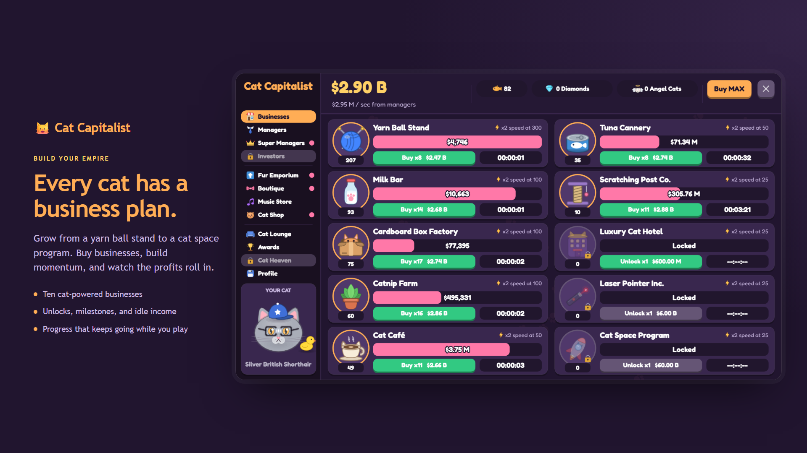
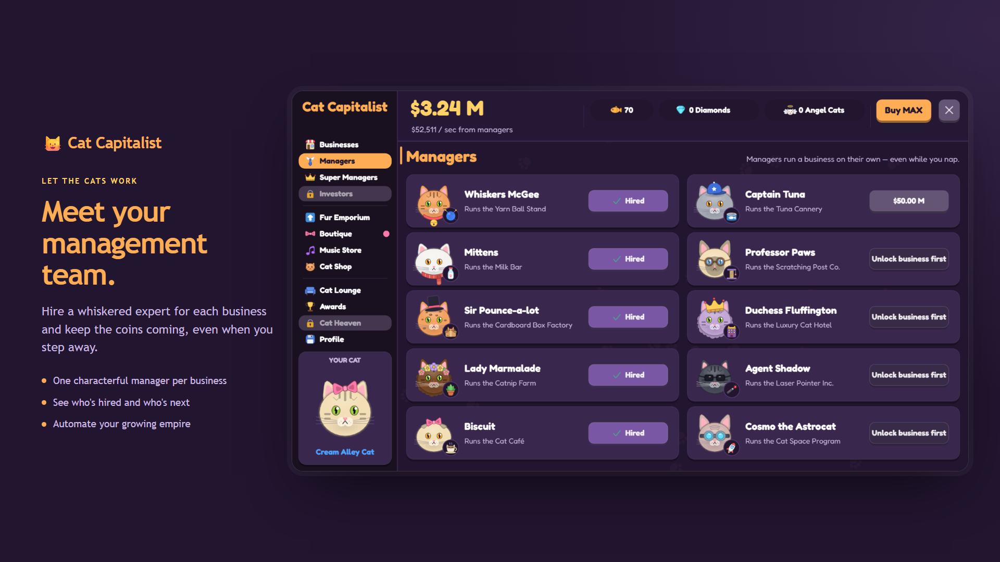
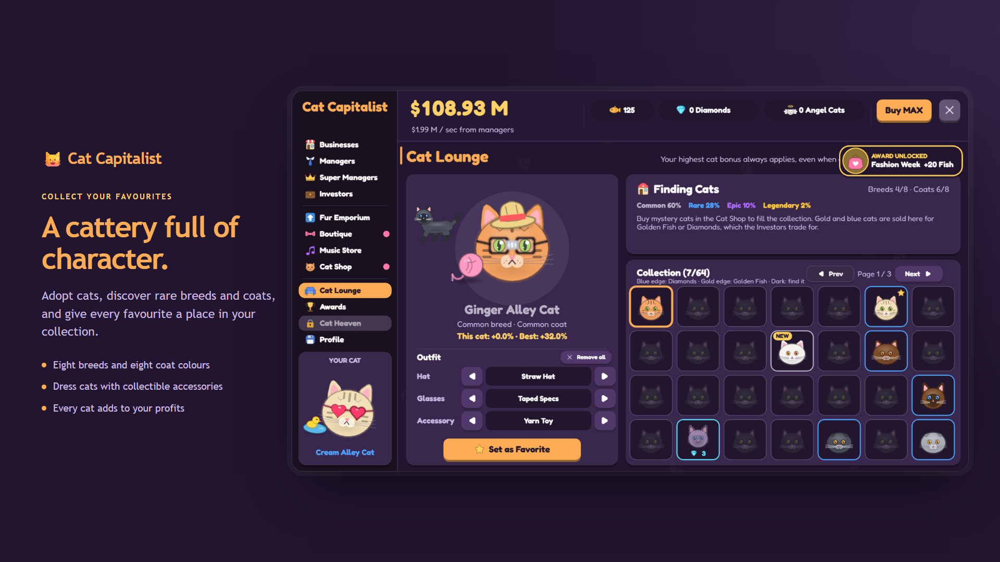
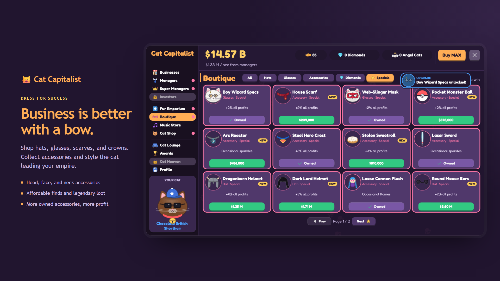
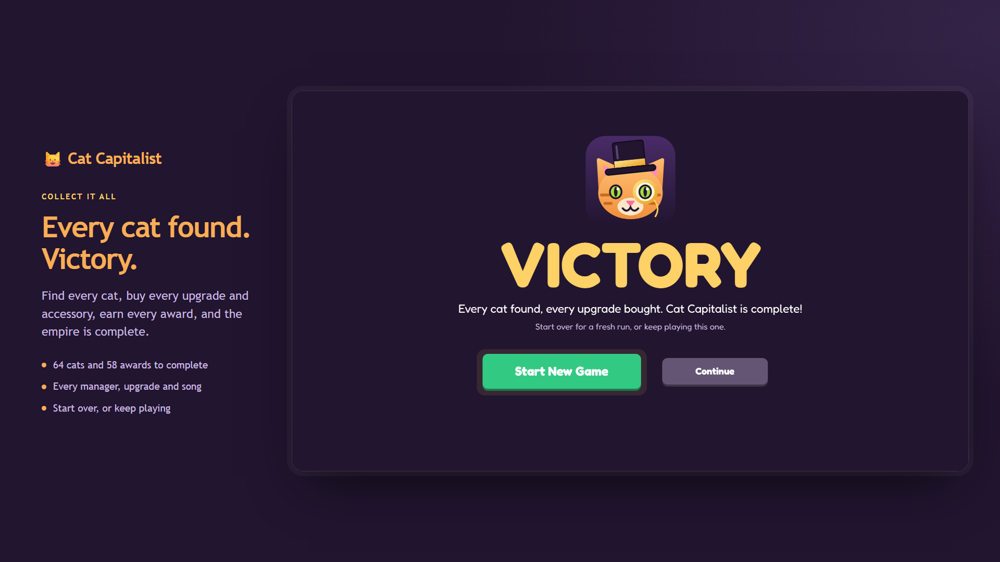

<p align="center"></p>

<h1 align="center">Cat Capitalist</h1>

<p align="center"><strong>Every cat has a business plan.</strong><br>An idle tycoon game for Windows and the browser, where a yarn ball stand grows into a cat space program.</p>



## The game

Start with one Yarn Ball Stand and a lot of ambition. Reinvest your profits, hire cat managers to keep things running while you're away, and work your way up through ten businesses.

### Build an empire

Buy businesses, reach milestones that double their speed, and back investors with timed deals once you have a super manager. Their returns wait for you, even after you close the game.

### Hire managers

Managers automate a business and keep it earning while the game is closed. Super managers go further, boosting a business for good.



### Upgrade everything

Upgrades triple the profits of a business, or of all of them. When a run slows down, ascend to Cat Heaven: you restart in exchange for Angel Cats and permanent upgrades.

### Collect cats

There are 64 breed and coat combinations, from a Ginger Alley Cat to a Golden Savannah, and your best cat boosts all your profits. Keep an eye out for strays too: cats wandering across the screen drop cash, Golden Fish or a burst of Zoomies.



### Dress them up

The Boutique's accessories look great and add permanent bonuses.



### Complete the game

Find every cat, buy every upgrade and accessory, hire every manager and earn every award, and the Victory screen is yours. Then start over, or keep playing.



## Play it

You need [Node.js](https://nodejs.org) 22.18 or newer, [pnpm](https://pnpm.io) and, for the desktop app, the [Tauri prerequisites](https://tauri.app/start/prerequisites/).

```bash
pnpm install
pnpm dev
```

The game opens in its own fullscreen window. Press **F11** to switch to a resizable window, or **Esc** or the **X** in the header to leave the game.

| Command                     | What it does                                                  |
| --------------------------- | ------------------------------------------------------------- |
| `pnpm dev`                  | Runs the desktop app with hot reload                          |
| `pnpm dev:web`              | Runs the browser version with hot reload                      |
| `pnpm build:desktop`        | Builds the desktop executable and installers                  |
| `pnpm build`                | Type-checks and builds the web version to `dist/`             |
| `node src/logic/check.ts`   | Runs the game-rules self-check                                |
| `node src/logic/balance.ts` | Checks the pacing of every game phase with a simulated player |
| `pnpm version:bump`         | Bumps the patch version and stages the files that carry it    |
| `pnpm update:app-version`   | Bumps the version everywhere (`major`, `minor` or `patch`)    |
| `pnpm update:tauri-version` | Copies the `package.json` version to Tauri and Cargo          |
| `pnpm check:versions`       | Confirms every manifest carries the same version              |

## Under the hood

Built with Phaser 4, TypeScript, Vite, a thin React shell and Tauri 2. The code structure, game formulas and conventions are in [ARCHITECTURE.md](ARCHITECTURE.md).

## Credits

- Music: [Brotheration Records](https://www.brotheration.com/)
- Sounds: [Kenney](https://kenney.nl)

Feel free to contact me:

- [LinkedIn](https://www.linkedin.com/in/mattiach/)
- mattiach.developer@gmail.com
